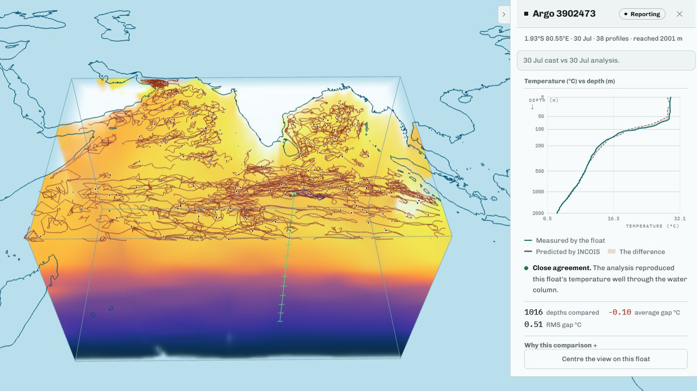
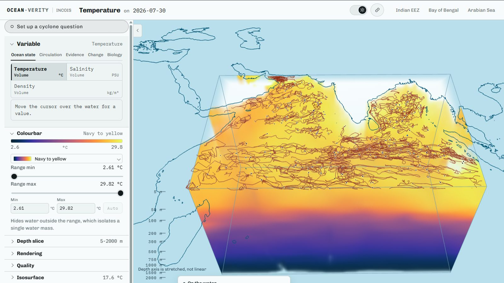
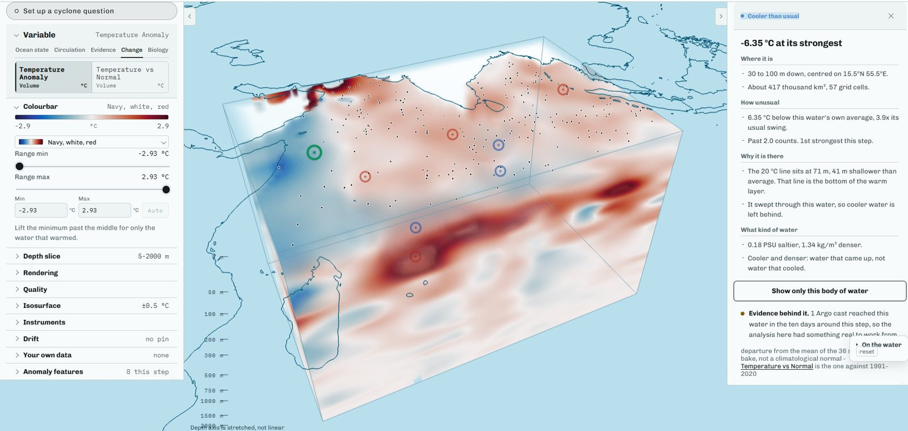
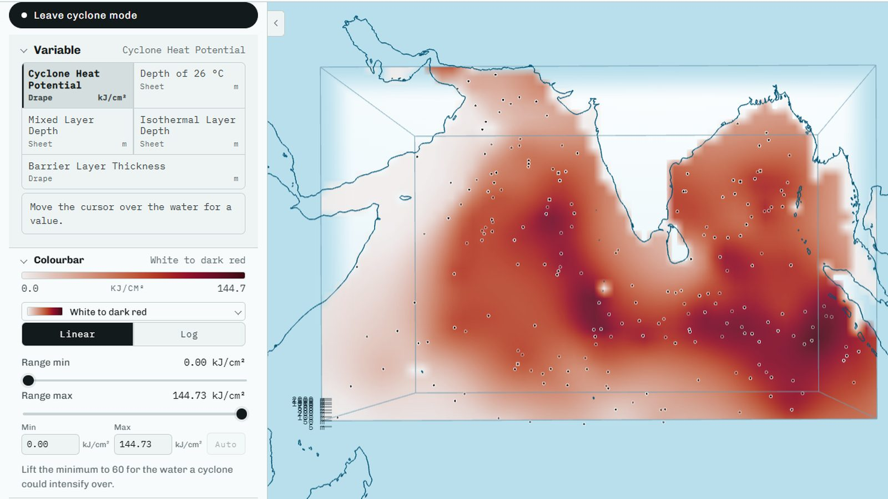
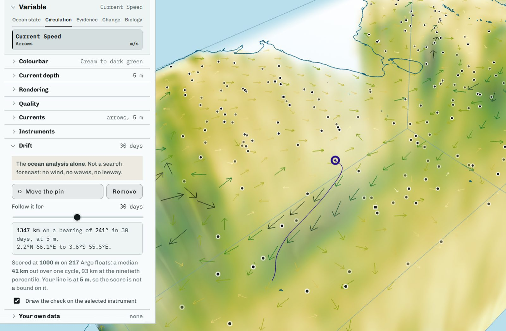
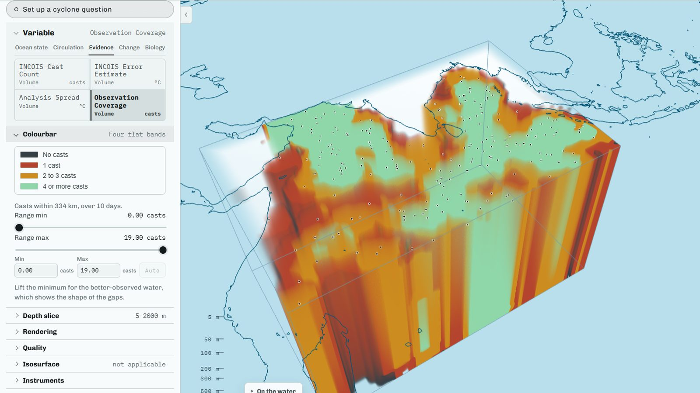
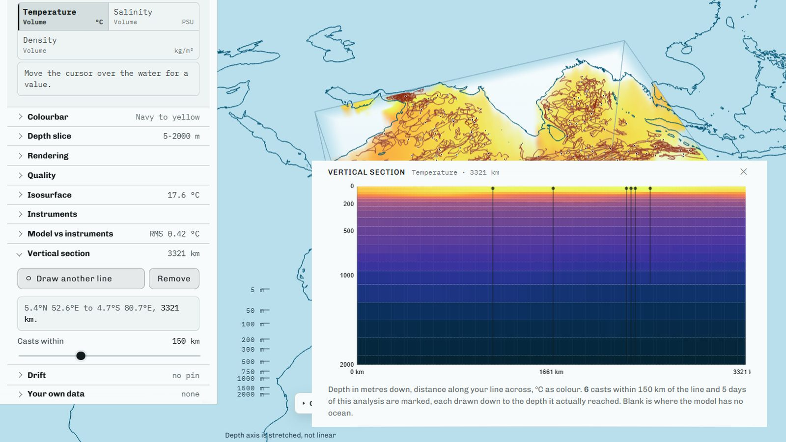
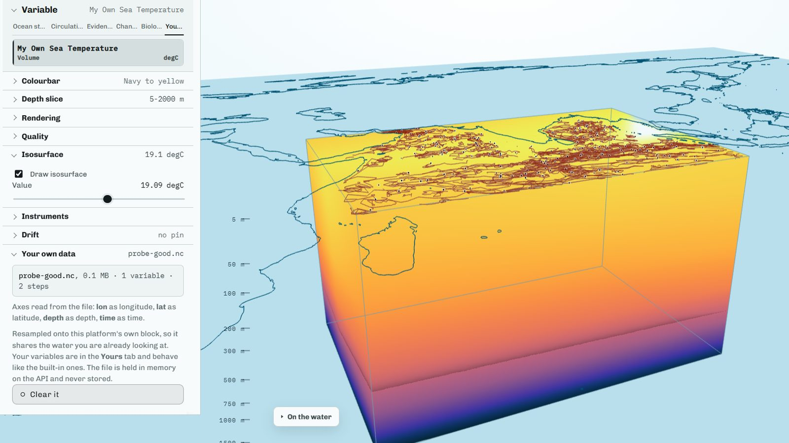
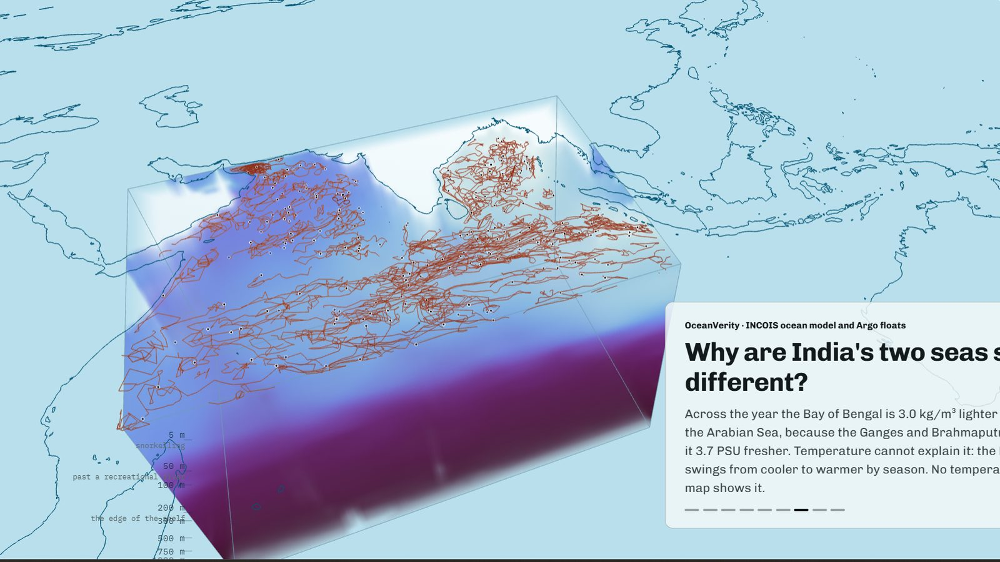
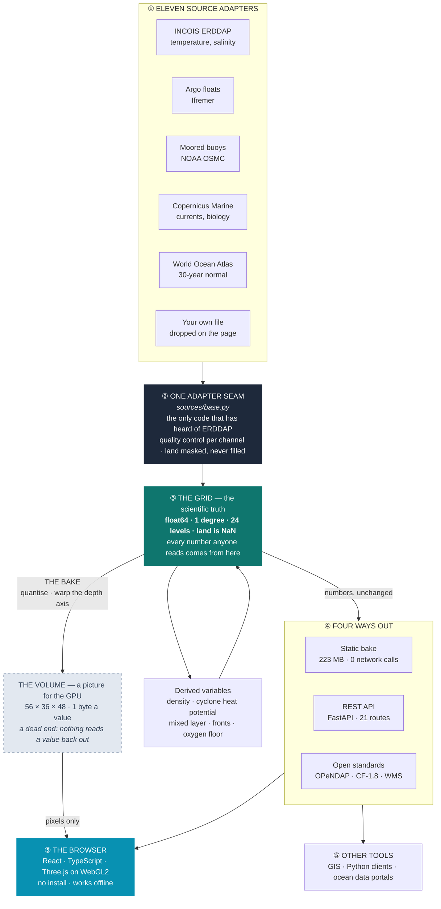

<div align="center">

# OceanVerity

**Fly into the Indian Ocean and see, in one picture, what the model predicted
and what the instruments in the water actually measured.**

[](https://rak2315.github.io/oceanverity/app.html)
[](https://rak2315.github.io/oceanverity/)
[](https://rak2315.github.io/oceanverity/provenance.html)




*One frame, and the whole idea. INCOIS's own ocean analysis as a block of water you fly into,
the floats drawn where they actually were, and one float's measurement scored against the model:
**1016 depths compared, 0.10 °C average gap, "close agreement"**.*

</div>

---

## In one minute

India runs an **ocean model** - a computed picture of temperature, saltiness and currents all the
way down. India also has **robot floats and anchored buoys** drifting in that same water, taking
real measurements.

Until now you could look at one or the other. Not both, in the same place, at the same depth, on
the same day.

**OceanVerity puts them together.** It draws the ocean as a solid block of water you can fly
inside, from the surface down to two kilometres, with every instrument sitting in it exactly
where it was. Click one and you see what it measured, what the model predicted, and how close the
two came.

It opens in an ordinary browser. Nothing to install, no account, no licence. **It works with the
internet switched off**, because the data travels with the page.

---

## What makes it different

**1. Every number arrives with its accuracy attached.** The platform compares the model against
all **274 instruments** in the water and prints the result. Across them the model sits within
about a quarter of a degree of what was measured, which is a genuinely good analysis - and
because the floats feed the model while the **17 anchored buoys** do not, the two are reported
separately, each with the depth range it covers. A forecaster can see at a glance not just what
the model says but how much to trust it, here, today.

**2. Every value you read is the real one.** The block on screen is a compressed copy built for
the graphics card. Every number a person or another program can obtain - the value under the
cursor, the comparison chart, a vertical slice, an API response - is read from the full-precision
data instead. The picture is for looking at; the numbers come from the source.

**3. It shows you where the evidence is.** One of the 19 variables exists purely to show how many
real measurements stand behind each part of the ocean. About a tenth of the block has none, and
that is drawn rather than filled in - which doubles as a map of where the next float would be
worth deploying.

**4. It has a door for everyone.** Nineteen variables is the right toolkit for a forecaster.
`Explore` turns the same platform into **nine plain questions** for students, the public and
policymakers, and `?kiosk=1` runs it unattended on an exhibition screen all day.

---

## The numbers

Every figure here is read off the running build by
[`pipeline/scripts/collect_facts.py`](pipeline/scripts/collect_facts.py). Nothing is typed by hand.

| | |
| --- | --- |
| Instruments in the water | **274** - 257 Argo floats + 17 moored buoys |
| Variables | **19**, in 6 groups; 4 published by INCOIS, 2 by Copernicus Marine, 13 computed here |
| Analyses | **36** timesteps, 10 Aug 2025 to 30 Jul 2026, over 45-100 °E and 10 °S-25 °N |
| Depth | **5 m to 2000 m** across 24 uneven levels |
| Data shipped in the build | **223 MB**, committed, **0** network calls to run |
| Source adapters | **11** - 10 providers, plus one for a file a visitor drops on the page |
| Tests / browser probes | **511** / **16** |
| Cyclone fields, validated | agree with INCOIS's own published archive in **97%** of 257,548 cells, across 183 dates from 2004 to 2019 |
| Drift model, scored | median **41 km** out over a ten-day Argo cycle, across 6,185 cycles on 217 floats |

---

## What it looks like

| | |
| --- | --- |
|  |  |
| **The water column.** The whole depth as one body, not a stack of slices. | **Unusual water, found for you.** Every departure gets a ring and a panel explaining it. |
|  |  |
| **Cyclone mode.** One press swaps in the five things a cyclone forecaster asks of the water. | **Drift.** Drop a pin, follow the current. The model comes with its own measured error. |
|  |  |
| **Where the evidence is.** How many real measurements stand behind each part of the water. | **Vertical section.** Draw a line, cut the ocean along it. |
|  |  |
| **Bring your own data.** Drop a NetCDF file on the page and it draws like everything else. | **Exhibition mode.** The same platform, for a room full of students. |

*Every picture is the running build. Nothing is a mockup and nothing is retouched.*

---

## How it works

**Eleven adapters feed one common form, and that form splits in two: the numbers stay exact, and
a compressed copy goes to the graphics card.** That split is the whole design, and it is what
guarantees point 2 above.



### The one rule the shape is drawn to show

**Every number a human or a machine reads comes from the Grid. The Volume's only arrow goes to
the screen.** This matters most at the API, because someone pulling a file over the network
cannot see which copy they were handed.

### Why one adapter per source matters

[`oceanverity/sources/base.py`](pipeline/oceanverity/sources/base.py) declares two interfaces and
nothing else. Eleven small classes implement them, and **they are the only code in the project
that has ever heard of ERDDAP**, or of a column layout, or of an FTP index. Each one asks its
provider for just the region and window needed, rather than downloading a global archive.

That is easy to claim, so it was tested: the September 2026 round added **four new providers** -
INCOIS's second analysis, Copernicus Marine, the EGO glider archive and the World Ocean Atlas -
and **touched no renderer, no endpoint and no interface file.**

### The three layers

| Layer | Responsible for | The seam below it |
| --- | --- | --- |
| **`pipeline/`** · Python | Reading every provider, quality-controlling every observation, computing every derived variable, writing the bake. **All tested logic lives here** - 511 tests. | `oceanverity/sources/base.py`. A provider is one class. |
| **`api/`** · FastAPI | What a static folder cannot answer: an arbitrary column, an arbitrary section line, an uploaded NetCDF file. Also serves OPeNDAP, CF-1.8 NetCDF and OGC WMS. | `data/grids/*.npz`. **Every endpoint reads the Grid.** |
| **`web/`** · React + TypeScript + Three.js | One WebGL scene for globe and volume, every control and panel, and the two pieces of science that must run offline. | `web/public/data/`. The browser reads **files, not endpoints**. |

They are genuinely separable: the pipeline runs with no browser, the browser runs with no API.
That is why the demo survives a dead network, and why the public deployment works with no server
behind it at all.

---

## The providers, in full

Each one public, each tested and dated in
[`docs/plan/00-data-sources-verified.md`](docs/plan/00-data-sources-verified.md).

| Provider | What it gives us |
| --- | --- |
| **INCOIS ERDDAP** `incois_argo_10d_VAM` | The 10-day gridded analysis - temperature and salinity |
| **INCOIS ERDDAP** 10-day McCreary | The second analysis, for the spread between them |
| **Argo GDAC** · Ifremer | Float profiles, with per-channel quality flags |
| **Argo BGC** · Ifremer | Chlorophyll on 57 of the floats and oxygen on 40 |
| **NOAA OSMC** | Moored buoys over GTS - a separate network from the floats |
| **Copernicus Marine** | Current vectors `uo`, `vo` at 1/12° |
| **Copernicus Marine** biogeochemistry | Chlorophyll and dissolved oxygen at 0.25°, and the oxygen floor |
| **Copernicus Marine** satellite | OSTIA sea surface temperature and gap-free chlorophyll, for surface fronts |
| **EGO glider GDAC** · `ftp.ifremer.fr` | The glider archive PS 26067 names |
| **World Ocean Atlas 2023** · NOAA NCEI | The 1991-2020 climatological normal |
| **Your own NetCDF file**, dropped on the page | The eleventh adapter, `POST /api/netcdf` |

---

## Tech stack

| Layer | What | Why this one |
| --- | --- | --- |
| **Science** | Python 3.10+, NumPy, xarray, netCDF4, gsw (TEOS-10) | `gsw` is the international standard for seawater density, so our derived variable is the one an oceanographer would compute. |
| **Colour** | cmocean | Perceptually uniform, and each scale is designed for a specific ocean quantity. A rainbow palette invents boundaries that are not in the data. |
| **Data access** | ERDDAP / OPeNDAP over `requests`, `pydap` | INCOIS and Argo both publish ERDDAP, so no scraping and no private endpoint. |
| **API** | FastAPI + `uvicorn` | Serves the queries a static bundle cannot precompute, and the three open standards below. |
| **Standards out** | OPeNDAP (DAP2), CF-1.8 NetCDF, OGC WMS 1.3.0 | So the analysis is readable by a Python client, a file, or a GIS - not only by this page. |
| **Rendering** | Three.js on WebGL2, GLSL ray marching | The volume is a single ray-marched block, not a stack of images. Nothing else gets you inside the water. |
| **Frontend** | React 18, TypeScript 5, Zustand, Vite | Zustand because every control is one flat store the scene reads once a frame; Vite for a four-page build with no config. |
| **Verification** | pytest, Playwright | 511 tests on the science; 16 Playwright probes that **measure the rendered page**. |
| **Fonts** | Chivo, IBM Plex Mono, Space Grotesk, Inter - all self-hosted | The demo makes zero network calls. A Google Fonts link would be a build failure, not a style choice. |

---

## Run it

**Prerequisites:** Python **3.10+**, Node **18+**, and a browser with WebGL2 (any current one).
No account, no API key, no database.

```bash
git clone https://github.com/RAK2315/oceanverity && cd oceanverity

# 1. install
python -m venv .venv
.venv/Scripts/pip install -r pipeline/requirements.txt      # Windows
# .venv/bin/pip install -r pipeline/requirements.txt        # macOS / Linux
cd web && npm install && cd ..

# 2. run the website
cd web && npm run dev                                       # http://localhost:5173
```

**That is the whole setup.** The baked data is committed, so the platform runs offline from a
fresh clone. The two steps below are optional.

```bash
# optional: the REST API and the three open standards
.venv/Scripts/python -m uvicorn api.main:app --port 8000    # /docs for the OpenAPI page

# optional: rebuild the data from source (a few minutes; needs one free Copernicus account
# for the current velocities, and nothing else)
cd pipeline && ../.venv/Scripts/python -m oceanverity.bake
```

### Check the claims yourself

Nothing in this README is asserted without something that can fail:

```bash
cd pipeline && ../.venv/Scripts/python -m pytest -q         # 511 tests
cd web && npm run typecheck && npx vite build

# the 16 browser probes measure the rendered page rather than trusting it.
# They need a preview server; each takes a minute or two.
cd web && npx vite preview --port 4173 &
node probe-guide.mjs        # every control is explained, every figure came from the bake
node probe-controls.mjs     # six rules per variable, checked rather than eyeballed
node probe-drift.mjs        # the browser's integrator against the pipeline's, in kilometres
node probe-landing.mjs      # no external request, and the hero's contrast in both themes
node probe-chrome.mjs       # every text role in the console, in both themes
```

`probe-section.mjs` and `probe-upload.mjs` additionally need the API on port 8000; the rest do not.

---

## Data credits

Argo data are collected and made freely available by the International Argo Program and the
national programmes that contribute to it. The Argo Program is part of the Global Ocean Observing
System. Gridded analysis products are produced by the **Indian National Centre for Ocean
Information Services (INCOIS)**, Ministry of Earth Sciences, Government of India. Cyclone track
data are **India Meteorological Department**, RSMC New Delhi. Current velocity, biogeochemistry
and satellite fields are **E.U. Copernicus Marine Service Information**. Climatology is **NOAA
World Ocean Atlas 2023**. Moored buoy observations via **NOAA OSMC**. Colour scales are
**cmocean** (Thyng et al., 2016). Coastlines are **Natural Earth**.
